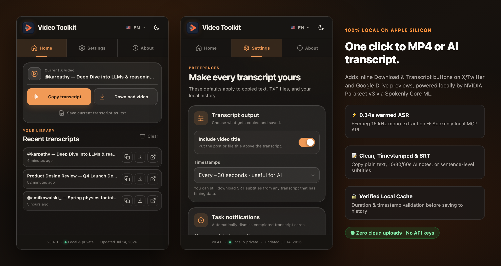
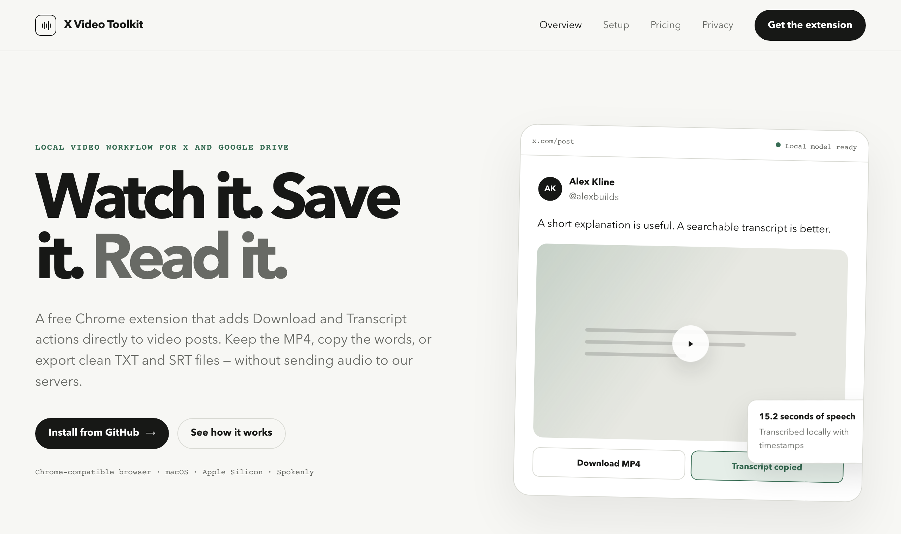

<p align="center">
  
</p>

<h1 align="center">X Video Toolkit</h1>

<p align="center">
  <strong>One-click X (Twitter) &amp; Google Drive video downloader with private local NVIDIA Parakeet v3 transcription.</strong><br/>
  Runs 100% locally on Apple Silicon macOS via Spokenly + Core ML — zero cloud uploads, zero API keys.
</p>

<p align="center">
  <a href="https://lemelson.github.io/x-post-toolkit/"></a>
  <a href="https://lemelson.github.io/x-post-toolkit/setup.html"></a>
  <a href="#install-on-an-apple-silicon-mac"></a>
</p>

<p align="center">
  <a href="https://developer.chrome.com/docs/extensions/develop/migrate/what-is-mv3"></a>
  <a href="https://support.apple.com/en-us/116943"></a>
  <a href="https://huggingface.co/nvidia/parakeet-tdt-0.6b-v3"></a>
  <a href="LICENSE"></a>
</p>

<p align="center">
  <a href="https://lemelson.github.io/x-post-toolkit/">Website</a> ·
  <a href="https://lemelson.github.io/x-post-toolkit/setup.html">Setup guide</a> ·
  <a href="https://lemelson.github.io/x-post-toolkit/privacy.html">Privacy policy</a> ·
  <a href="#install-on-an-apple-silicon-mac">Install</a> ·
  <a href="#how-local-transcription-works">Architecture</a>
</p>

<p align="center">
  
</p>

<details>
<summary><strong>Project Website &amp; Inline Workflow Preview</strong></summary>
<br/>
<p align="center">
  
</p>
</details>

**X Video Toolkit** is a privacy-first Chrome/Chromium extension that adds
**Download** and **Transcript** buttons directly to supported X (Twitter) video
posts and Google Drive video previews.

One click can download the best available MP4 or turn the video's speech into
copyable text, timestamped notes, TXT, or SRT subtitles. Transcription runs
locally on macOS through [Spokenly](https://spokenly.app/) using the
Apple-Silicon-optimized Core ML conversion of **NVIDIA Parakeet TDT 0.6B v3**.

> This is currently an unpacked developer extension, not a Chrome Web Store
> release. It requires macOS, Spokenly, FFmpeg, and a one-time Native Messaging
> host setup.

## What it does

| Action | Result |
| --- | --- |
| Download an X/Twitter video | Saves the best available MP4 in one click |
| Transcribe an X/Twitter video | Copies a local AI transcript without uploading audio to this project |
| Work with Google Drive video previews | Adds the same download and transcript workflow |
| Copy with timestamps | Produces AI-friendly notes every 10, 30, or 60 seconds |
| Export subtitles | Creates sentence-level SRT output |
| Reuse previous work | Stores verified transcripts locally for the configured retention window |

### Main features

- Inline **Download** and **Transcript** actions on supported video pages.
- X/Twitter media resolution for primary, quoted, retweeted, and nested videos.
- The lightest MP4 with the best available audio is preferred for transcription.
- Audio-only HLS and additional MP4 variants remain as fallbacks.
- Bottom-right progress notifications for download, transcription, retry, and clipboard stages.
- Duration validation prevents truncated audio from being accepted.
- Timestamp coverage validation prevents incomplete transcripts from entering history.
- Automatic retries for interrupted downloads and recoverable ASR failures.
- Transcript history with:
  - clean copy;
  - timestamped copy;
  - TXT download;
  - SRT subtitle download;
  - source post/file link.
- Configurable history size, retention, title inclusion, and timestamp frequency.
- No telemetry or hosted backend operated by this repository.

## Supported websites and browsers

### Websites

- X / Twitter video posts whose media is accessible to the browser/native host.
- Google Drive video preview pages after the active player exposes a media URL.

Protected, deleted, region-blocked, expired, or otherwise inaccessible media may
not be downloadable. “One click” describes the interaction, not a bypass of
platform permissions.

### Browsers

- Google Chrome
- Helium
- Comet
- Arc
- Brave
- Microsoft Edge
- Vivaldi
- Chromium
- Opera

The installer writes Native Messaging manifests for the supported Chromium
locations it finds on macOS.

## How local transcription works

```mermaid
flowchart LR
    A["X / Twitter or Google Drive page"] --> B["Extension content script"]
    B --> C["Manifest V3 service worker"]
    C --> D["Native Messaging host"]
    D --> E["FFmpeg: temporary 16 kHz mono WAV"]
    E --> F["Spokenly local API"]
    F --> G["FluidAudio + Core ML<br/>NVIDIA Parakeet v3"]
    G --> H["Text + word timestamps"]
    H --> I["Clipboard, history, TXT, SRT"]
```



The extension does not run a second 2.5 GB Hugging Face/MLX copy of Parakeet.
It calls Spokenly's local `transcribe_file` API at `127.0.0.1` and verifies
that the selected file-transcription model is `parakeetTDT06`.

Spokenly uses [FluidAudio](https://github.com/FluidInference/FluidAudio) and the
[Core ML Parakeet v3 conversion](https://huggingface.co/FluidInference/parakeet-tdt-0.6b-v3-coreml),
which is designed for Apple hardware. Core ML can use the CPU, GPU, and Apple
Neural Engine through the system runtime.

### Core ML versus MLX

Both are Apple-Silicon inference technologies, but they are different runtimes
and use different model conversions:

- **This repository's default:** Spokenly → FluidAudio → Core ML → Parakeet v3.
- **Possible custom backend:** a Python or Swift MLX port with separate weights.

Do not download both unless another application explicitly requires the MLX
version. For this extension, the Spokenly/Core ML model is sufficient.

## Install on an Apple Silicon Mac

### 1. Install prerequisites

Install [Homebrew](https://brew.sh/) if needed, then:

```bash
brew install ffmpeg python
```

Download and install the current **sideload macOS version** of
[Spokenly](https://spokenly.app/releases/macos). Keep Spokenly running in the
background while using the extension.

### 2. Download the correct Parakeet model in Spokenly

In Spokenly:

1. Open **Settings**.
2. Open **Dictation Models** or **Transcribe File**, depending on the current UI.
3. Download **NVIDIA Parakeet TDT 0.6B v3**.
4. Select it as the model used by **Transcribe File**.
5. Enable **Voice for AI Agents (MCP)** so Spokenly's local server is available.
6. Optional: enable **Local-only mode** to block online providers.

Spokenly downloads the optimized Core ML files automatically. You do **not**
need to download the original NVIDIA repository or
`mlx-community/parakeet-tdt-0.6b-v3` for this setup.

The official NVIDIA model is
[`nvidia/parakeet-tdt-0.6b-v3`](https://huggingface.co/nvidia/parakeet-tdt-0.6b-v3):
a 600-million-parameter multilingual speech-to-text model with punctuation,
capitalization, and timestamps. Spokenly uses a converted Core ML build suitable
for local inference on Apple Silicon.

### 3. Clone the extension

```bash
git clone https://github.com/Lemelson/x-post-toolkit.git
cd x-post-toolkit
```

### 4. Load it as an unpacked extension

1. Open your browser's extensions page:
   - Chrome: `chrome://extensions`
   - Edge: `edge://extensions`
   - Brave: `brave://extensions`
   - or the equivalent page in another Chromium browser.
2. Enable **Developer mode**.
3. Choose **Load unpacked**.
4. Select the cloned `x-post-toolkit` folder.

### 5. Install the Native Messaging host

From the repository root:

```bash
./scripts/install_native_host.sh
```

The installer normally detects the unpacked extension ID. If detection fails:

```bash
./scripts/install_native_host.sh <extension_id>
```

Then reload the extension and refresh the X/Twitter or Google Drive page.

The installer may create a lightweight `parakeet-mlx` compatibility command
for older local tools. It routes those calls to Spokenly and does not download a
second model. If a real `parakeet-mlx` command already exists, the installer
preserves it.

## Usage

### Download or transcribe from the page

1. Open a supported X/Twitter post or Google Drive video preview.
2. Use the injected **Download** or **Transcript** button.
3. Watch the progress notification.
4. The completed transcript is copied and saved to local extension history.

### Use the popup

Open the extension popup to:

- act on the current video;
- browse recent transcripts;
- copy clean or timestamped text;
- download TXT or SRT;
- change retention and formatting preferences.

Verified transcripts are reused during the configured retention window, so
clicking Transcript again does not rerun the model unnecessarily.

## The personal use case behind this integration

This version came from a practical local-AI cleanup:

1. I installed Spokenly and downloaded NVIDIA Parakeet TDT 0.6B v3 inside the app.
2. Spokenly installed an Apple-optimized Core ML/FluidAudio conversion.
3. I asked an AI coding agent to inspect the real local setup and connect this
   extension to the same model.
4. The agent benchmarked the previous standalone MLX path and the Spokenly path
   on the same X/Twitter video.
5. After the Spokenly path returned correct text and timestamps, the extension
   was switched to it and the duplicate 2.5 GB model was removed.
6. A tiny compatibility wrapper kept older local tools working through the same
   single Spokenly model.

On that machine, one 15.232-second test clip completed in 1.558 seconds
end-to-end, including media access and audio extraction; the warmed Spokenly ASR
stage took 0.342 seconds. These are informal local measurements, not a controlled
vendor benchmark. Hardware, cache state, media delivery, audio length, and
background load can change the result substantially. A later cold run after the
model had unloaded took 11.2 seconds, so the warmed number is not a startup-time
guarantee.

## Guide for AI coding agents

If you ask an AI agent to install or adapt this project, give it this checklist:

1. Inspect the real repository, current git diff, and existing Native Messaging host.
2. Confirm Spokenly is installed, running, and using `parakeetTDT06` for file transcription.
3. Confirm `http://127.0.0.1:51089` exposes the local `transcribe_file` tool.
4. Run a known audio fixture through Spokenly before changing code.
5. Preserve FFmpeg duration checks and transcript timestamp coverage validation.
6. Never delete an older ASR backend until the replacement passes the same-file test.
7. Search other local projects before removing a shared command or model.
8. Run `npm run check`, a secret scan, and a real end-to-end transcription.
9. Treat generated code and documentation as untrusted until reviewed.

The implementation contract and JSON examples are documented in
[`docs/AI_INTEGRATION.md`](docs/AI_INTEGRATION.md).

## Privacy and security

- Media still has to be fetched from X/Twitter or Google Drive.
- FFmpeg extracts temporary audio into a per-request temporary directory.
- Temporary audio is deleted after the request completes.
- Spokenly receives a local file path through its loopback-only local API.
- With Parakeet selected, transcription happens locally on the Mac.
- Transcript text, timestamps, source URL, and a short preview are stored in
  `chrome.storage.local`.
- This repository contains no analytics SDK, telemetry endpoint, API key, or
  project-operated transcription server.

See [`SECURITY.md`](SECURITY.md) for the public-repository checklist and
responsible disclosure guidance.

## Architecture

- `content.js` — shared page lifecycle and injected UI.
- `content_x_adapter.js` — X/Twitter post and video context.
- `content_drive_adapter.js` — Google Drive preview context.
- `background.js` — queue and message router.
- `src/background/context.js` — normalized item identity and metadata.
- `src/background/media.js` — media discovery and audio-quality-aware ranking.
- `src/background/native.js` — Native Messaging transport and progress stream.
- `src/background/store.js` — verified transcript cache, history, and settings.
- `src/background/format.js` — timestamp, TXT, and SRT formatting.
- `scripts/native_host.py` — FFmpeg, validation, Spokenly API, and result contract.
- `scripts/install_native_host.sh` — browser host installation.
- `scripts/spokenly_parakeet_compat.py` — optional legacy CLI bridge.

## Development

```bash
npm test
npm run check
```

`npm run check` validates JavaScript syntax, runs Node and Python tests, compiles
the Python host, and checks the shell scripts.

## Troubleshooting

### Native host is unavailable

```bash
./scripts/install_native_host.sh <extension_id>
```

Reload the extension and refresh the page afterward.

### Spokenly is unavailable

- Start Spokenly.
- Enable **Voice for AI Agents (MCP)**.
- Confirm **NVIDIA Parakeet TDT 0.6B v3** is selected for file transcription.
- Keep Local-only mode enabled if you do not want fallback to online providers.

### FFmpeg is missing

```bash
brew install ffmpeg
which ffmpeg
```

### No downloadable MP4 found

The post may be private, deleted, protected, region-restricted, expired, or use
a media form not currently handled by the extension.

### Incomplete download or transcription

The extension retries recoverable failures. Failed or incomplete transcripts
are not cached. Local diagnostics are written to:

```text
~/Library/Logs/xvdl-native-host.log
```

## Uninstall the Native Messaging host

```bash
./scripts/uninstall_native_host.sh
```

The uninstaller removes this project's browser manifests and binaries. It removes
the `parakeet-mlx` compatibility command only when that command belongs to this
project.

## AI-assisted development disclaimer

This software and parts of its documentation were created and reviewed with the
help of artificial intelligence. AI can misunderstand APIs, overlook edge cases,
or produce incorrect documentation. Review the source, test with non-sensitive
media first, and verify privacy/security assumptions for your own environment.

The project is not affiliated with X Corp., Google, NVIDIA, Apple, FluidInference,
or Spokenly. Product names and trademarks belong to their respective owners.

## License

[MIT](LICENSE)
